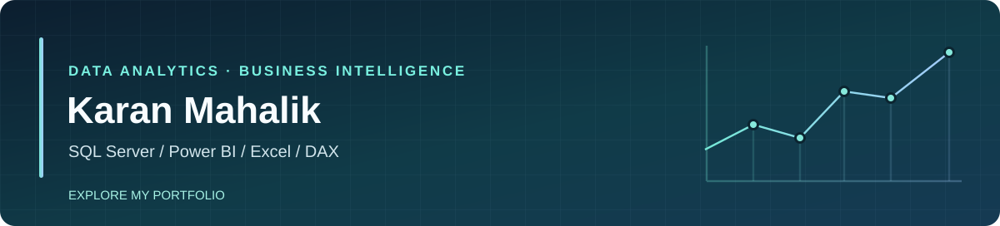

  

# Karan Mahalik
**Data Analyst · Power BI Developer · SQL Developer**

I work with SQL, Power BI, Excel, and Python to turn structured data into clear reports and actionable business insights. My computer science background and application-development experience also help me understand where business data comes from, how it is stored, and how it reaches a dashboard.

📍 Cuttack, Odisha, India · 🎓 B.Tech, Computer Science & Engineering, DRIEMS University (2022–2026)

**🌐 Current portfolio:** [Explore my Data Analyst & Power BI portfolio](https://karan-mahalik-portfolio.vercel.app/) — my primary professional website.

[**Featured analytics projects**](#featured-analytics-repositories-primary-focus) · [**Technical skills**](#focus-analytics-first-engineering-second) · [**Experience**](#experience--education) · [**LinkedIn**](https://www.linkedin.com/in/karan-mahalik-122438369/) · [**Portfolio**](https://karan-mahalik-portfolio.vercel.app/) · [**Email**](mailto:karanmahalik88@gmail.com)

[GitHub portfolio page source](docs/index.html) (separate static reference, not the Vercel deployment)

## Focus: analytics first, engineering second

- **Data analysis & reporting (primary focus):** SQL Server, T-SQL, MySQL, Power BI, DAX, Power Query, Excel, data cleaning, KPI reporting, customer and sales analysis.
- **Supporting skills:** Python fundamentals, pandas, NumPy, relational databases, Git and GitHub.
- **Full-stack development:** React, JavaScript, Spring Boot, Node.js, Express, REST APIs and database-backed workflows.

## Featured analytics repositories (primary focus)

Both repositories now contain the uploaded original data files, original SQL scripts, Power BI reports, and supporting project documentation, organized into dedicated folders. **The files have not yet been independently validated for data correctness, SQL execution, privacy or Power BI refresh.** Project descriptions below are from my supplied resume.

| Project | Scope described in my resume | GitHub project |
| --- | --- | --- |
| **Pizza Sales Performance Analysis** | Sales and order KPIs, demand trends, product comparisons, Power BI reporting and DAX measures | [PizzaSalesAnalysis](https://github.com/karan-mahalik/PizzaSalesAnalysis) |
| **UrbanCart Sales & Customer Analytics** | Data quality, SQL views, revenue trends, repeat customers, returns, delivery metrics and Power BI reporting | [UrbanCartAnalysis](https://github.com/karan-mahalik/UrbanCartAnalysis) |

Each project includes a [pizza case-study summary](case-studies/pizza-sales-performance.md) or [UrbanCart case-study summary](case-studies/urbancart-sales-customer.md) showing the planned evidence and verification status. Example SQL and DAX are labeled as **illustrative**, not original or independently executed.

## Public development projects

These repositories demonstrate the complementary software-development side of my profile.

| Project | What the repository contains |
| --- | --- |
| [Stilique frontend](https://github.com/karan-mahalik/stilique-frontend) + [backend](https://github.com/karan-mahalik/stilique-backend) | React storefront and a Spring Boot/MySQL REST API, illustrating relational data and application integration |
| [PulseChat frontend](https://github.com/karan-mahalik/PulseChat) + [server](https://github.com/karan-mahalik/PulseChat-Server) | React and Node/Express/MongoDB chat application source with Socket.IO integration |
| [Movie Suggestion App](https://github.com/karan-mahalik/Movie-Suggestion-App) | React movie discovery interface using external movie data |

## Experience & education

- **Full Stack Development Intern — Generative AI Techshila (GATS)** · May–Sep 2025: React components, REST APIs, Spring Boot and MySQL-backed application flows.
- **Software Engineer Trainee — Alpha Finder** · May–Sep 2025: Backend services, API workflows, SQL-based retrieval and application debugging.
- **B.Tech in CSE — DRIEMS University** · 2022–2026 · CGPA: 8.28 (as listed on my resume).

## What I'm pursuing

Junior **Data Analyst**, **Power BI Developer**, and **SQL / BI Analyst** opportunities where I can apply business intelligence, database skills and practical reporting. I also bring full-stack experience to data-focused engineering collaborations.

**Connect:** [**LinkedIn**](https://www.linkedin.com/in/karan-mahalik-122438369/) · [**Portfolio**](https://karan-mahalik-portfolio.vercel.app/) · [**Email**](mailto:karanmahalik88@gmail.com)

_Uploaded source assets are organized in both repositories; SQL Server and Power BI runtime validation and data-quality/privacy review remain pending. No certifications or performance numbers are claimed without evidence._
